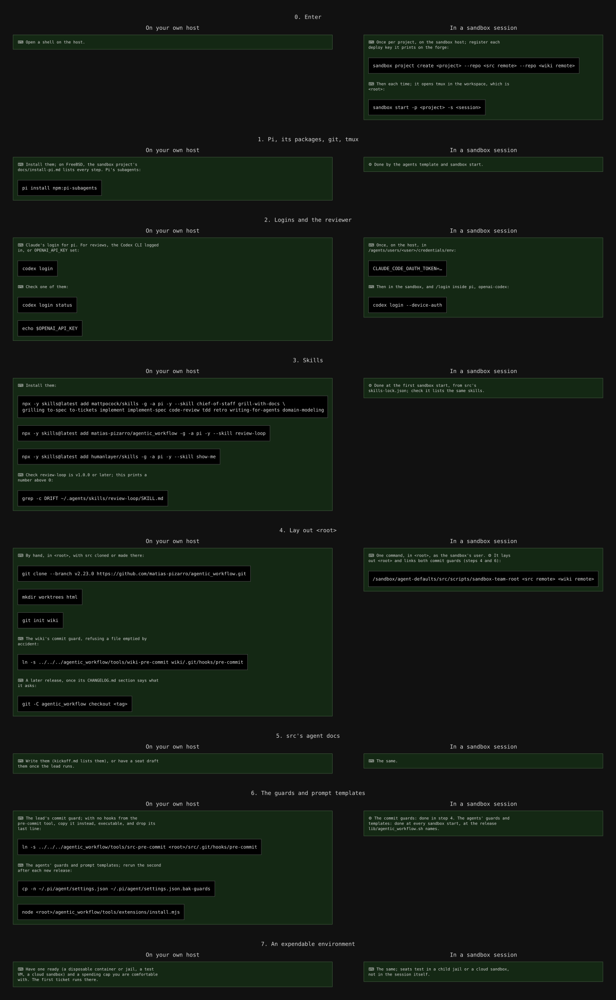

# Kickoff: the first hour

A checklist. `<root>` is defined at the top of [index.md](index.md); the why behind each step is there too.

A team runs on your own host or in a sandbox session; each setup step shows both, side by side. Who does it:
- **⌨️ You type:** commands you run, or text you write, yourself.
- **💬 You answer:** you read what the lead shows and reply.
- **⚙️ Automated:** a script or an agent does it; you only watch, or check the result.

The sandbox column is the sandbox project's tooling (`sandbox`, in its `docs/install-sandbox.md`), with a sandbox host already set up; another project's sandbox tooling may differ.

## Before the lead starts

Steps 0 to 7 are drawn in [kickoff-setup.svg](kickoff-setup.svg), each step with your own host on the left and a sandbox session on the right, and every command in a box of its own. Open the SVG itself in a browser to copy a command: its text can be selected there, though not in the picture below. Its source is [kickoff-setup.reladraw](kickoff-setup.reladraw); render it again with `reladraw render docs/kickoff-setup.reladraw` after a change.



**The layout (step 4).** Every project gets the same layout and tools, filled with its own content: its own wiki and its own docs tooling, never shared with another project. `src`, `wiki` and `agentic_workflow` are three separate git repositories; `worktrees/` holds linked worktrees of `src`, one per branch, made by seats with `git worktree add`:
```
<root>/
  src/               the project repo
  wiki/              the lead's memory: private, never inside src
  agentic_workflow/  a clone of this repo, at a release tag
  worktrees/         linked worktrees of src
  html/              the pages named to the operator (rules.md, Team mechanics), outside every repo
```
The team script runs from `<root>/agentic_workflow/tools/team.sh` and keeps its queue and agent list beside it, git-ignored. In a sandbox session, `<root>/agentic_workflow` and the start's install come at the sandbox tooling's release (`lib/agentic_workflow.sh` in the sandbox project), which moves when Methodology names a release for it and the host's setup reruns.

**The skills (step 3).** `show-me` explains the current topic with diagrams, code-shape sketches and focused HTML pages; it runs only when you type `/skill:show-me`. Where it would `open` an HTML file, the agent names its full path instead (rules.md, Team mechanics). `grilling` stays installed: `grill-with-docs` and `review-loop` load it. `review-loop` before v1.0.0 lacks the impact ratings, backlog, drift question and delete option.

**The agent docs (step 5),** each short:
- `AGENTS.md`, with this line, `<root>` written out as the real path: `Process rules: <root>/agentic_workflow/docs/rules.md, beside this repo's main checkout. Read them before any ticket, review or question.`;
- `docs/agents/issue-tracker.md`: tickets as `.scratch/<feature>/issues/NN-<slug>.md`, shaped as [rules.md](rules.md) rule 1 says;
- `.scratch/backlog.md`: an empty backlog;
- `CODING_STANDARDS.md`: the judgement rules a reviewer enforces; anything mechanical goes in a hook instead;
- an ADR for the threat model (every agent assumed compromised) and one for simplicity (no option, layer or generality without a concrete second case).

**The guards (step 6).** The lead's commit guard refuses any commit made with `TEAM_ROLE=lead`, then runs the hooks the `pre-commit` tool installed, kept as `pre-commit.generated`. The agents' guards are a Pi extension refusing tool calls known to go wrong (the README's "Guards" lists them) and `/open-questions`, which makes a seat reprint in its pane every question of yours it still awaits.

## Start the lead

The same on a host and in a sandbox session, in a tmux window in `<root>/wiki`.

8. ⌨️ Start it:
   ```sh
   cd <root>/wiki && TEAM_ROLE=lead pi
   ```
   then, in that pane's shell, or after `!` in Pi:
   ```sh
   tmux set -p @role lead
   ```

9. ⌨️ Type, with `<root>` written out:
   ```
   /skill:chief-of-staff
   Goal: <one paragraph, in your words>.
   Follow <root>/agentic_workflow/docs/rules.md. The wiki is <root>/wiki; the project is <root>/src; the team script is <root>/agentic_workflow/tools/team.sh. Every task file names the rules by that absolute path.
   Start the wiki (index.md, goal.md), then ask me the sizing question for the first piece of work.
   ```

## The first exchange

The same on a host and in a sandbox session, but for what rules.md's Team mechanics says of pages and the signal in a sandbox.

10. ⚙️ **Check the wiki start.** The lead writes it; you read it: `goal.md` holds your goal with a date; `index.md` lists it.

11. 💬 **Answer the first sizing question.** It quotes your words, says what each tier would build and recommends the lowest. An option labelled `widens:` adds something you did not ask for. Pick consciously.

12. 💬 **Name the seats.** Tell the lead the project's builder areas, a name for each (one lowercase, expressive word: GLOSSARY.md, "Seat name"), and which of them stay always on (rules.md rule 16). ⚙️ The lead spawns the coordinators, `architect`, `coach`, `librarian` and `heimdall`, and the always-on builders first; the other builders roll on when their area gets work.

13. ⚙️ **Watch the first seat spawn.** Its task file's first line is `Ceremony: <tier> (the operator, "<your words>", <date> hh:mm)`. This shows its `STATUS` line:
    ```sh
    <root>/agentic_workflow/tools/team.sh status
    ```

14. 💬 **Answer in the format.** `yes`, `no`, your own words, `ok` (trust without full understanding) or `why?`, by ID. A go typed in a seat's pane counts.

## Signs it is working

- The first ticket ran live on the expendable host before any review.
- Every summary opens with its running-cost line.
- Questions arrive one ID each, with a `➡️` you can accept with `yes`.

## Signs to stop and ask `why?`

- A recommendation bigger than what you asked for, with no `widens:` label.
- A request of yours to make something reusable turned into a framework, with no question about who else uses it.
- Round after round of findings in code the previous round wrote, with no `❓ DRIFT` question.
- A test or check standing in for a live run, with no question asking your approval.
